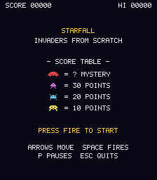
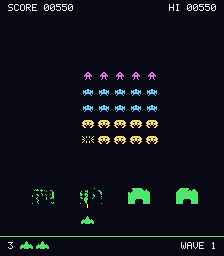

# Learning: Space Invaders from Scratch (an invaders-style shooter, in Rust)

**Source:** Nick Tasios, "Space Invaders from Scratch", Parts 1–5, from the C/C++ section of
[practical-tutorials/project-based-learning](https://github.com/practical-tutorials/project-based-learning).
The series builds the game in C++ with a window, a CPU-side pixel buffer and hand-made sprites.
nicktasios.nl could not be reached from the build environment, so this follows the series' **subject, not
its text**. It is written in Rust instead of C++, and the sprites, game name and tuning are original.

> Written by the daily-project routine (Claude), as a worked example to compare against.

<p>
  
  
</p>

## What it is

**Starfall** is a small arcade shooter in the invaders genre. Fifty-five aliens march side to side in a
block. Each time the block reaches a wall, it drops one row and turns around. You slide a ship along the
bottom and shoot upward, hiding behind four shields that wear away as they are hit. The aliens speed up as
their numbers fall. A mystery saucer sometimes crosses the top for bonus points. If the aliens reach your
row, the game ends at once.

Every pixel is drawn by our own code into a 224×256 buffer of `u32`s. A window library (minifb) only copies
that buffer to the screen. There is no GPU code, no game engine and no image crate. Even the PNG screenshots
come from a hand-written encoder. It is about 1,850 lines of Rust plus about 750 lines of tests.

## Run it

```powershell
winget install Rustlang.Rustup        # then open a new terminal
rustc --version                       # check that the toolchain is on PATH
cargo run --release                   # play in a window
```

Controls: **←/→** or **A/D** move, **Space** fires, **P** pauses, **Esc** quits.

```
cargo run --release -- --headless --seed 7              # the autopilot plays one game and prints a summary
cargo run --release -- --headless --shot end.png        # ...and saves the last frame as a PNG
cargo run --release -- --headless --shot t.png --shot-at 1500   # screenshot at tick 1500 (25 s in)
cargo build --release --no-default-features             # headless-only build, zero dependencies
cargo test                                              # 38 tests
```

The same commands work on Linux and macOS. minifb needs no extra system packages on Windows or macOS. On
Linux it needs the X11 development headers.

**Tests:** `cargo test` runs **38 tests**. 19 are unit tests: sprite parsing and pixel-exact overlap,
clipping, the font, the RNG, enemy fire rules, the saucer, and PNG checksums against known values. 16 are
behaviour tests that play the game tick by tick. They cover shooting an alien through a shield gap, shields
wearing away from above and below, the march turning at the wall, the speed-up, losing a life, game over and
restart, invasion, wave clear, shots cancelling each other, the extra life, replaying a game from its seed,
the autopilot clearing wave 1, and the renderer. 3 tests run the real binary; one checks its PNG against
Python's zlib as an independent decoder. `cargo clippy --all-targets` is clean with and without the window
feature.

## How it fits together

```
 keys ──► Input ──► Game::update()  ──► Vec<Event>
                     (one 1/60 s tick,      │
                      pure, seeded)         ▼
                         │            (scores, deaths, sound hooks...)
                         ▼
                    render(&Game, &mut Buffer) ──► minifb window   (or)  png::encode_rgb ──► file
```

| File | What it owns |
|---|---|
| `sprite.rs` | `Sprite` (a 1-bit bitmap parsed from ASCII art), pixel-exact `overlap_at`, `Rect` |
| `art.rs` | every sprite, written as `#`/`.` strings, parsed once into a `OnceLock` |
| `buffer.rs` | the framebuffer: `clear`, `set`, `fill_rect`, `draw_sprite` with clipping, PPM output |
| `font.rs` | a 5×7 bitmap font: 46 glyphs stored as 7 rows of 5 bits |
| `game.rs` | all game rules: phases, formation march, firing, collisions, scoring, waves |
| `render.rs` | turns a `Game` into pixels; never changes game state |
| `autopilot.rs` | a simple bot used for the headless demo and the end-to-end test |
| `png.rs` | PNG chunks + CRC-32 + zlib/Adler-32 + fixed-Huffman deflate with greedy LZ77 |
| `main.rs` | argument parsing, the fixed-timestep window loop, the headless runner |

## What it teaches

### 1. A software framebuffer is the whole graphics stack

The game never asks a graphics API to "draw a sprite". `Buffer` is a `Vec<u32>` of `0x00RRGGBB` pixels, and
`draw_sprite` is two nested loops that write a colour wherever the sprite's bit is set. Pixels that fall off
the edge are clipped one at a time. Once a frame is finished, the whole buffer goes to the window in one call
(`update_with_buffer`). The same buffer can just as easily go to a PNG file. That is why the headless mode
and the screenshots above need no display. Integer pixel coordinates also mean collisions and drawing agree
exactly, with no floating-point rounding between them.

### 2. Sprites as data, and pixel-exact collision

Sprites are ASCII art in the source:

```rust
brute: [ s(&["..########..",
             ".##########.",
             "###..##..###", ...
```

`Sprite::from_art` panics on ragged rows, so a typo in the art fails the first time the art loads. A unit
test loads all of it.

Collision first does a cheap bounding-box test. Only if the boxes intersect does it walk the shared rectangle
looking for a pixel set in both sprites. A shot that passes between an alien's legs really misses. The test
`boxes_touching_but_pixels_apart_do_not_overlap` pins this down. `overlap_at` returns *where* the first
shared pixel is, and shields use that point to carve a crater there.

Bullet against bullet is the one exception. Two thin zig-zag shots moving toward each other can cross without
sharing a pixel on any tick, so that case uses the bounding boxes (`Rect::intersects`).

### 3. Destructible terrain is just a mutable sprite

Each shield starts as a clone of the shield art. A hit clears a small diamond around the impact point, plus
three random chips so craters don't all look stamped. When the formation passes over a shield, every set
pixel of every living alien is cleared from it. Because shields are ordinary sprites, the overlap test that
detects alien hits works on them unchanged.

### 4. The game as a pure, seeded state machine

`Game::update(input)` advances **exactly one tick** and returns `Event`s. It has no clock, no I/O and no
hidden randomness, because the RNG lives inside `Game` and is seeded at creation. So:

- The window loop uses a **fixed timestep**. It adds up real elapsed time and calls `update` once per 1/60 s
  that has passed (capped at 5 ticks after a stall). Game speed doesn't depend on frame rate.
- `render` only reads the game, so drawing can never change the outcome.
- The tests drive real games tick by tick. They can put a shot or the formation exactly where they want,
  then assert on events. `the_same_seed_replays_the_same_game` checks that a whole 4,000-tick game replays
  identically from its seed.

The phases are an enum: `Title → Playing → PlayerDying(t) → Playing | GameOver(t)`, and
`Playing → WaveClear(t) → Playing`. Timed phases carry their countdown inside the variant. That makes "what
happens on this tick" a single `match`.

### 5. Turning a held key into a press

The window reports keys as up or down. If you fired whenever Space was down, holding it would autofire. The
game remembers last tick's fire key and only shoots on an up→down change (`fire_pressed`). The game-over
screen also ignores fire for 90 ticks. That way, a player who is still hammering Space when they die doesn't
skip straight past the game-over screen. Both rules have tests.

### 6. The march, and why it speeds up

The formation is one offset plus a direction. Every `march_interval()` ticks it moves 2 px. If the next step
would push the outermost **living** column past the margin, the formation drops 8 px and reverses instead.
Using living columns matters: once you clear a side column, the block travels further before it turns.

The interval is `1 + alive / 2` ticks, minus a small bonus on later waves. With 55 aliens it steps every 28
ticks. The last alien steps every tick, which is 120 px per second. The speed-up is the genre's difficulty
curve. Enemy fire follows rules too. Only the lowest living alien in a column can shoot. Half the time the
shooting column is the one nearest the player, so standing still is never safe. At most three enemy shots can
be on screen at once.

### 7. Writing a PNG encoder in ~200 lines

A PNG file is a signature followed by chunks, each with a length, a type, the data and a CRC-32. The pixels
go in IDAT as a zlib stream. `png.rs` uses deflate's **fixed Huffman** block type (RFC 1951 §3.2.6), so there
are no code tables to build or send. A greedy LZ77 pass hashes every 3-byte prefix to find earlier matches.
Two bit-order details are easy to get wrong. Deflate packs ordinary values least-significant bit first, but
Huffman codes are defined most-significant bit first, so codes are bit-reversed before packing. Length 258
also has its own code (285, no extra bits) rather than being 227 plus 31. A 172 KB frame shrinks to about
5 KB.

## Things that went wrong while building it

- **Nearby seeds played the same game.** The first RNG constructor was `Rng(seed ^ K | 1)`. In Rust, `|`
  binds more loosely than `^`, so this is `(seed ^ K) | 1`, and seeds 2 and 3 gave the same state. The
  headless runs showed it: seeds 2/3, 4/5 and 6/7 printed identical summaries. The fix runs the seed through
  a splitmix64 round first. A test now checks 64 pairs of seeds that differ only in the lowest bit.
- **The bot couldn't finish a wave.** It aimed straight at the nearest alien. That works against a slow,
  full formation, but the last few aliens move up to 120 px/s, and a shot takes about 25 ticks to climb.
  Leading the target fixed it: lead = (flight ticks ÷ march interval) × 2 px in the march direction. The
  share of shots that hit went from about 25% to about 41%, and the bot went from usually dying in wave 1 to
  clearing 2–8 waves on most seeds.
- **Scripted tests were shot by the game.** Two behaviour tests failed at first, but not because of game
  bugs. Real enemy fire kept running during the scenario and killed the player partway through. Those tests
  now clear enemy shots each tick, so they test the march and the life counter rather than luck.

## Differences from the tutorial

- **Rust, not C++.** minifb stands in for the series' window and OpenGL setup. Its job is the same: put a
  CPU-drawn buffer on screen.
- **Original art and name.** All sprites, the font, the colours and the "Starfall" name were drawn for this
  project. The mechanics are the genre's own: a marching formation, shields, a bonus saucer, one player shot
  at a time.
- **Extras the series may not cover** (it could not be checked): destructible shields, enemy fire, the
  saucer, waves that start lower, an extra life at 1,500 points, a high score, pause, the autopilot, and the
  headless mode with PNG screenshots.

## Try next

1. **Sound:** `update` already returns `Shot`, `AlienKilled`, `PlayerHit` and other events. Play a short
   sample for each one in `main.rs` without touching `game.rs`.
2. **Save the high score** to a file in the user's config directory, and load it at startup.
3. **Replays:** record the `Input` of every tick into a file. Because the game is deterministic, the seed and
   the inputs are enough to replay a whole game exactly.
4. **Better compression:** pick a PNG row filter per scanline (Sub/Up/Paeth), or add dynamic Huffman blocks,
   and measure how much smaller the screenshots get.

## License

Licensed under the MIT License; see the LICENSE file at the repository root.
Follows the subject of "Space Invaders from Scratch" by Nick Tasios (http://nicktasios.nl/posts/space-invaders-from-scratch-part-1.html).
